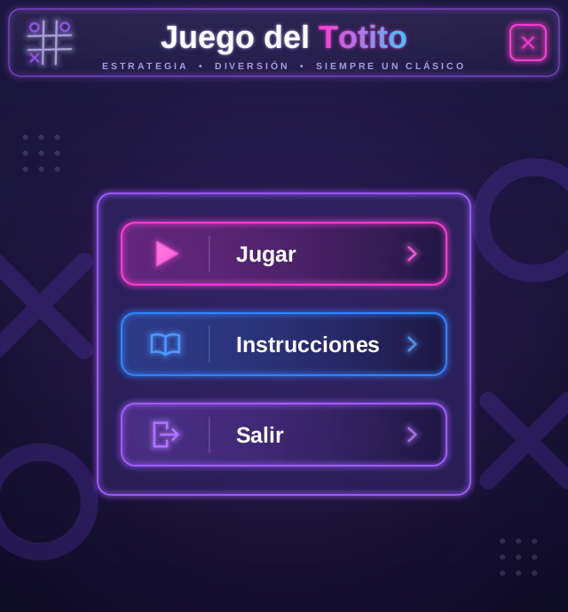
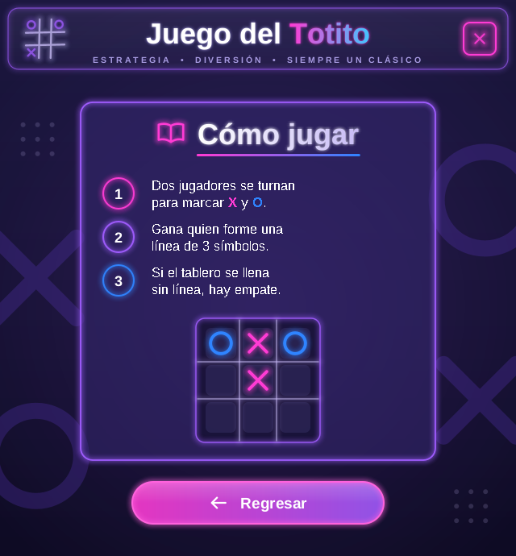
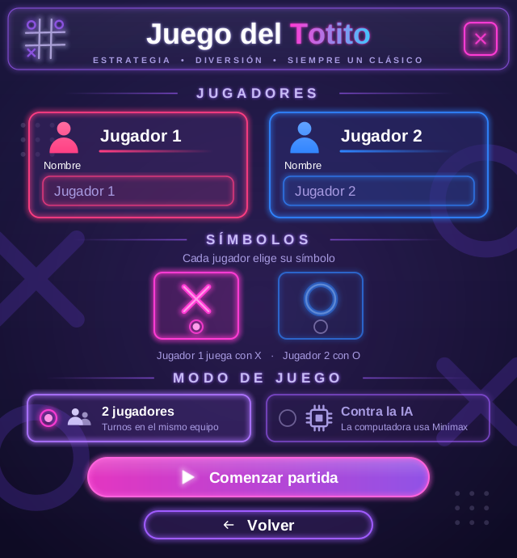
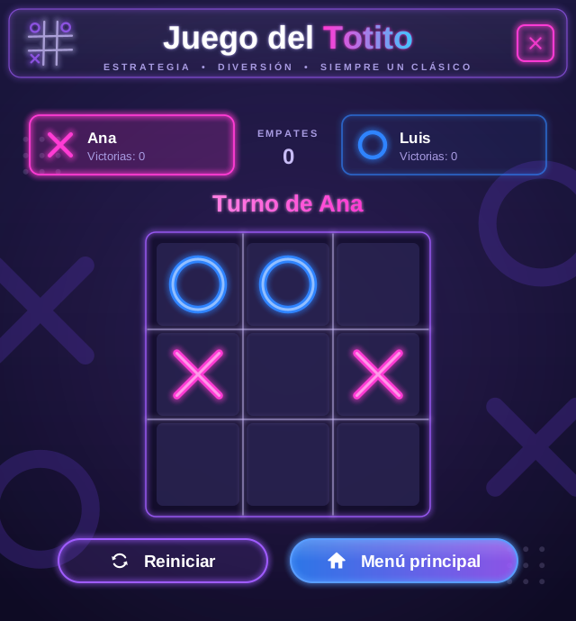
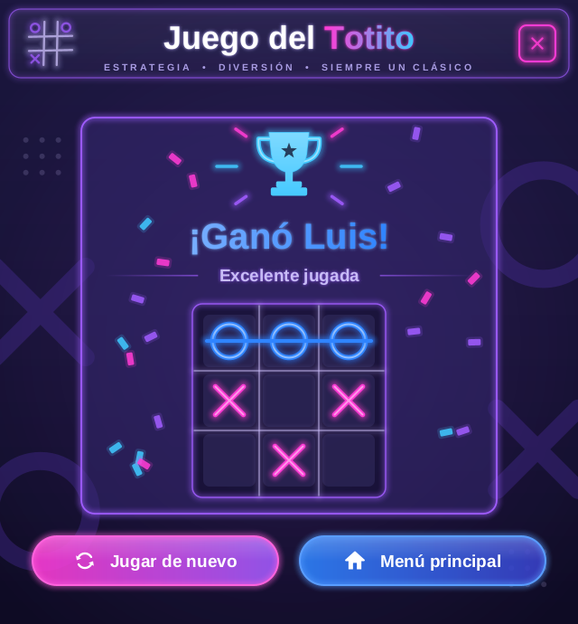
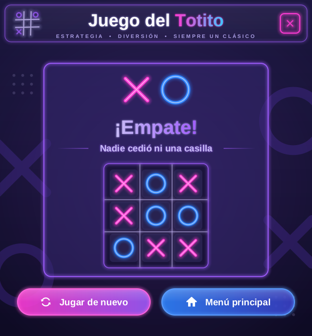

# Juego del Totito (tres en línea) — interfaz neón

Totito para dos personas en el mismo equipo, o contra una IA que usa
**Minimax** y nunca pierde. La interfaz es Java **Swing** con estilo neón,
y todo está dibujado con código (Java2D), sin imágenes ni librerías extra.

| Menú | Instrucciones | Configuración |
|---|---|---|
|  |  |  |

| Partida | Victoria | Empate |
|---|---|---|
|  |  |  |

> 📄 **Documentación completa:** [`docs/Integracion_Grafica_Totito.pdf`](docs/Integracion_Grafica_Totito.pdf) explica
> qué se hizo y por qué, la arquitectura y **cada archivo bloque por bloque** (con números de línea).

---

## 1. Qué se necesita

- **JDK 17 o más nuevo** (cualquiera: Oracle, Temurin, el que trae NetBeans…).
- Nada más: el proyecto no tiene dependencias.

Para comprobar el JDK: `java -version` y `javac -version` en una terminal.

## 2. Cómo ejecutarlo

**Con NetBeans (o IntelliJ):** *File → Open Project* → elegir la carpeta
`Totito`. Se abre como proyecto Maven. Luego, botón **Run**: arranca
`TotitoApp`.

**Con Maven desde la terminal:**

```bash
cd Totito
mvn package
java -jar target/Totito-1.0-SNAPSHOT.jar
```

**Sin Maven, solo con el JDK:**

```bash
cd Totito
javac -encoding UTF-8 -d out src/*.java
java -cp out TotitoApp
```

> Hay que poner `-encoding UTF-8`: los textos llevan tildes y signos
> (¡, ó, í). Sin esa opción, en Windows se ven caracteres raros.

La versión original (ventana sencilla, solo contra la IA) se sigue
pudiendo abrir con `java -cp out JuegoMain`.

## 3. Cómo se juega

1. **Jugar** → se escriben los nombres (si se dejan vacíos quedan
   "Jugador 1" y "Jugador 2").
2. **Símbolos**: la caja marcada es la del Jugador 1, y el Jugador 2 usa la
   otra. **Siempre empieza la X.**
3. **Modo de juego**:
   - *2 jugadores*: se turnan en el mismo equipo.
   - *Contra la IA*: el Jugador 2 es la computadora. Si al Jugador 1 le
     toca la O, la computadora abre la partida.
4. Al ganar se ve la raya sobre las tres fichas y luego la pantalla de
   resultado. **Jugar de nuevo** mantiene a los mismos jugadores y suma al
   marcador; **Menú principal** empieza de cero.

## 4. Cómo está organizado el código

Todo está en `src/`, sin paquetes, como venía el proyecto original.
Cada clase empieza con un comentario que explica para qué sirve.

### Código original (no se modificó)

| Clase | Qué hace |
|---|---|
| `Tablero` | Las 9 casillas: marcar, ¿hay ganador?, ¿está lleno?, copiar. |
| `Jugador` | Nombre y ficha (`'X'` u `'O'`). |
| `IA_Minimax` | Calcula la mejor jugada de la computadora recorriendo todas las partidas posibles. |
| `JuegoMain` | La ventana original (Jugador contra IA). Se dejó como estaba. |

### Lo nuevo: la lógica

| Clase | Qué hace |
|---|---|
| `Partida` | Une `Tablero`, `Jugador` e `IA_Minimax`: turnos, quién ganó, marcador, modo (2 jugadores / IA). **No sabe nada de la interfaz.** También da la posición de la línea ganadora para dibujar la raya. |

### Lo nuevo: la interfaz

```
TotitoApp (JFrame, tiene el main)
 └─ PanelPrincipal  (CardLayout: muestra una pantalla a la vez; implementa Navegacion)
     ├─ PantallaMenu            ← diseño 1
     ├─ PantallaInstrucciones   ← diseño 2
     ├─ PantallaConfiguracion   ← diseño 3
     ├─ PantallaJuego           ← tablero de la partida (mismo estilo, no venía en el diseño)
     └─ PantallaResultado       ← diseño 4 (victoria) y también empate
```

Todas las pantallas heredan de **`PantallaBase`**, que pinta el fondo
(degradado, X y O gigantes, puntos) y pone el **`Encabezado`** (logo,
título y botón de cerrar).

Las pantallas no se conocen entre sí. Para cambiar de pantalla llaman a la
interfaz **`Navegacion`** (`irAlMenu()`, `iniciarPartida(...)`, …), y
`PanelPrincipal` hace el cambio.

**Componentes reutilizables:**

| Clase | Qué es |
|---|---|
| `BotonNeon` | Botón con 4 estilos: `menu(...)`, `pildora(...)`, `contorno(...)`, `icono(...)`. Es un `JButton`: se usa con `addActionListener`. |
| `Tarjeta` | Caja "de cristal" con borde de neón; se le agregan componentes como a un `JPanel`. |
| `Rotulo` | Títulos: `titulo(...)` (grande, con degradado), `seccion(...)` ("— JUGADORES —"), `leyenda(...)`. |
| `PanelTablero` | Dibuja un `Tablero` y avisa de los clics. Solo dibuja, no decide nada. |
| `TarjetaJugador`, `CampoTexto` | Tarjeta con el nombre del jugador y su caja de texto (máx. 14 letras). |
| `SelectorSimbolo`, `OpcionModo` | Elegir X/O y el modo de juego. |
| `PanelMarcador` | Victorias de cada jugador y empates. |
| `PasoInstruccion`, `IconoResultado` | Piezas de las pantallas de instrucciones y resultado. |

**Estilo:**

| Clase | Qué contiene |
|---|---|
| `Tema` | **Todos los colores y fuentes.** Para cambiar el aspecto, se cambia aquí. |
| `Dibujo` | Ayudas de dibujo: el efecto neón (`trazoNeon`), las fichas X/O y el texto con halo. |
| `Iconos` | Los iconos (play, libro, casa, trofeo…) dibujados con figuras. |

### Cómo funciona el "neón"

`Dibujo.trazoNeon` traza la misma figura 6 veces: primero muy gruesa y
casi transparente, y cada vez más fina y opaca. Encima va la línea normal
y, en trazos gruesos, un centro casi blanco. El ojo lo ve como luz
difuminada. Todos los bordes, fichas e iconos usan esa misma función.

## 5. Cómo seguir trabajando

- **Cambiar colores o la letra:** `Tema.java`.
- **Agregar una pantalla:** crear `class PantallaX extends PantallaBase`,
  agregar componentes con `agregar(...)`, `espacio(...)` y `relleno()`,
  registrarla en `PanelPrincipal` (`add(new PantallaX(this), "x")`) y
  agregar el método que la muestra en `Navegacion`.
- **Agregar un icono:** copiar una constante de `Iconos.java`. Las medidas
  van como fracción del tamaño `t`.
- **Cambiar reglas o el turno inicial:** `Partida.java`
  (`FICHA_INICIAL`, `jugar`, `reiniciar`).
- **Tamaño de la ventana:** `PanelPrincipal.ANCHO/ALTO` (640×690, cabe en
  pantallas de 1366×768). La ventana no se redimensiona.

### Ideas pendientes

- Niveles de dificultad para la IA: por ejemplo, que a veces haga una
  jugada al azar en lugar de la de Minimax.
- Alternar quién empieza en cada "Jugar de nuevo".
- Animar la raya ganadora y el confeti (con un `javax.swing.Timer`).
- Sonidos al marcar y al ganar.
- Jugar con el teclado (teclas 1–9).

## 6. Qué se verificó

- Compila con `javac` y con `mvn package`, para Java 17 (probado con el JDK 21).
- Reglas: casilla ocupada, turnos, victoria, empate, marcador y reinicio.
- La IA **nunca pierde**: se revisaron por programa las 642 partidas
  completas posibles contra ella (con el humano empezando y con la IA
  empezando).
- Flujo con clics reales sobre el tablero en modo IA, hasta la pantalla de
  resultado.
- Las capturas de `docs/capturas/` se generaron con este mismo código.
